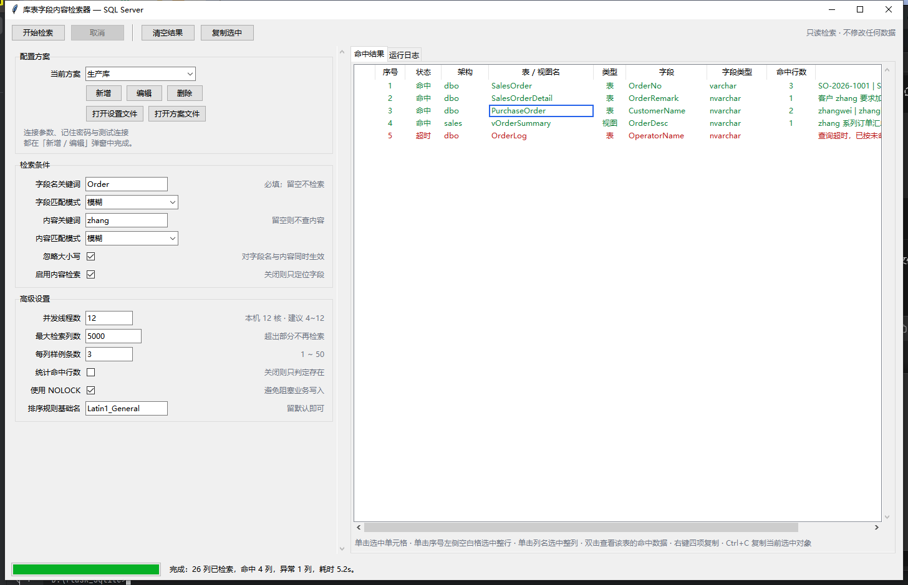
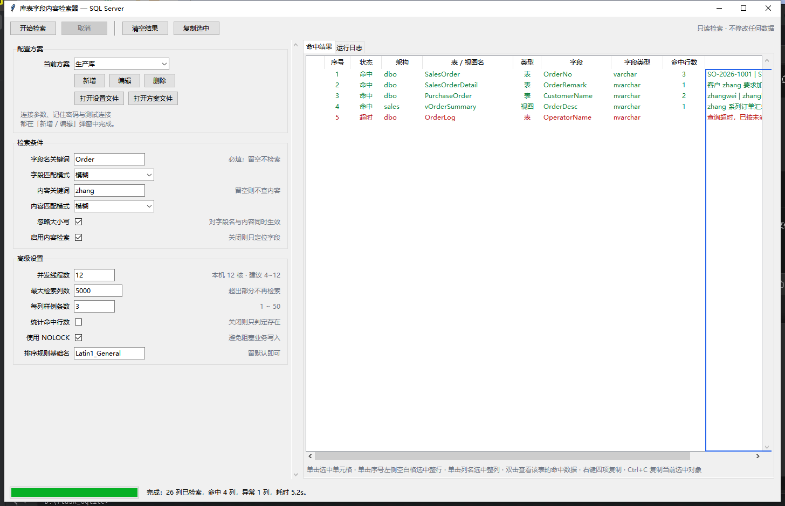

# 库表字段内容检索器（MssqlFieldFinder）

> 在 SQL Server 中**先按字段名定位表/视图，再在这些字段里检索内容**的 Windows 桌面工具。  
> 典型用途：拿到一个业务字段名（如 `OrderNo`），快速找出库中哪些表有这一列，  
> 以及**哪些表的这一列里真的存着某个值**（如某个客户名、某张单号）。

> **数据库支持范围：当前版本仅支持 Microsoft SQL Server，暂不支持其他类型数据库。**
> 这意味着 MySQL、PostgreSQL、Oracle、SQLite、达梦 / 人大金仓等国产数据库均无法连接——
> 程序从连接驱动（`Microsoft ODBC Driver for SQL Server`）到元数据查询（`INFORMATION_SCHEMA`）、
> 内容探测语法（`SELECT TOP (n)`、`COLLATE`、`WITH (NOLOCK)`）都是按 SQL Server 的方言实现的，
> 换成其他数据库既无法建立连接，也无法执行上述语句。
> 若业务上有跨数据库类型的检索需求，需要针对目标库另行适配，不在本版能力范围内。


**下载可执行文件**：[Releases 页面](https://github.com/cxk-lc/MssqlFieldFinder/releases)  
（版本 `v1.6.0`，文件名 `MssqlFieldFinder-v1.6.0.exe`）

**只读承诺**：全代码只执行 `SELECT` 与 `INFORMATION_SCHEMA` 查询，不含任何 DDL/DML。  
不会创建、修改、删除任何数据。

---

## 目录

- [功能特性](#功能特性)
- [快速开始](#快速开始)
- [界面说明](#界面说明)
- [参数详解](#参数详解)
- [检索是怎么跑的](#检索是怎么跑的)
- [结果表操作](#结果表操作)
- [配置文件](#配置文件)
- [自行打包](#自行打包)
- [常见问题](#常见问题)
- [项目结构](#项目结构)
- [开发与测试](#开发与测试)
- [已知限制](#已知限制)

---

## 功能特性

| 分类         | 能力                                        |
| ---------- | ----------------------------------------- |
| **两阶段检索**  | 阶段 A 从元数据按字段名筛出候选列；阶段 B 只对这些列做内容探测。避免全库盲扫 |
| **两种匹配**   | 字段名与内容各自可选「精准 / 模糊」，各自可选是否忽略大小写           |
| **多线程**    | 列级并发探测，线程数可按机器核数自动取值，也可手调                 |
| **命中下钻**   | 双击结果行打开「命中数据」窗口，直接看该表里符合条件的数据行（最多 200 行）  |
| **结果复制**   | 单元格 / 整行 / 整列 / 全部结果，四种复制方式，可直接粘进 Excel   |
| **多套连接方案** | 生产库、测试库各存一个方案，下拉切换；每个方案独立决定是否保存密码         |
| **驱动自检**   | 自动优选本机最好的 SQL Server 驱动；一个都没有时给出官方下载链接    |
| **配置精简**   | 配置文件只写「与默认值不同」的项；未改过任何设置时不生成文件            |

---

## 快速开始

### 方式一：从 Release 页面下载（推荐给使用者）

> 统一通过 **GitHub Release** 分发。

**下载地址**

| 入口                | 链接                                                    |
| ----------------- | ----------------------------------------------------- |
| Release 列表页（找最新版） | <https://github.com/cxk-lc/MssqlFieldFinder/releases> |

**版本号与文件名格式**

Release 的 tag 命名为 `v<版本号>`，本版为 **`v1.6.0`**；下载到的资产文件名与之对应：

```
MssqlFieldFinder-v<版本号>.exe

例如：MssqlFieldFinder-v1.6.0.exe
```

> 若列表页中没有该版本，说明对应 Release 尚未发布——请改走「方式二」或「自行打包」。

**使用步骤**

1. 按上表任一入口下载 `MssqlFieldFinder-v1.6.0.exe`；
2. 放到任意目录（例如 `D:\Tools\MssqlFieldFinder\`）后双击运行；
3. 首次运行会在 exe 同级目录自动生成 `config.json` / `connections.json`。

前置条件与说明：

- 目标机器**不需要安装 Python**。
- 但需要安装 **Microsoft ODBC Driver for SQL Server**（缺失时程序内会显示红色下载链接）。
- 单文件版首次启动需解包到临时目录，约 1~3 秒属正常。

**体检命令**（在 exe 所在目录打开 cmd 执行）：

```bat
MssqlFieldFinder-v1.6.0.exe --check
MssqlFieldFinder-v1.6.0.exe --version
```

### 方式二：从源码运行（开发调试）

```bat
:: 1) 安装依赖（只需 pyodbc；tkinter 随 Python 提供）
python -m pip install -r requirements.txt

:: 2) 启动
bat\run.bat
```

`bat\run.bat` 会自动探测本机可用的 Python 解释器（要求同时具备 tkinter 与 pyodbc），  
并用真实执行 `import tkinter, pyodbc` 的方式做能力探测。不确定环境时先运行：

```bat
bat\诊断环境.bat
```

它会把本机所有候选解释器的 tkinter / pyodbc 能力与可用 ODBC 驱动列出来。

### 环境要求

| 场景          | 要求                                                                 |
| ----------- | ------------------------------------------------------------------ |
| 运行 exe（使用者） | Windows 10/11 x64；`Microsoft ODBC Driver for SQL Server`；无需 Python |
| 运行源码（开发者）   | 含 tkinter 的 Python 3.9+（安装时勾选 `tcl/tk and IDLE`）+ `pyodbc`         |
| 自行打包（构建者）   | 上述开发环境 + `PyInstaller`（`bat\build.bat` 会在缺失时自动安装）                  |

> `pyodbc` 在代码中是**惰性导入**的：即使没装 pyodbc，280 项纯逻辑单元测试仍能全部通过，  
> 因此逻辑层的开发与验证不依赖数据库驱动。

---

## 界面说明



界面分四个区域：

| 区域           | 内容                              |
| ------------ | ------------------------------- |
| **工具栏**      | 开始检索 / 取消 / 清空结果 / 复制选中         |
| **左侧表单**     | 配置方案（选连接）、检索条件、高级设置。表单较长时可滚动    |
| **右侧上：命中结果** | 结果表，下方有一行随状态变化的操作提示             |
| **右侧下：运行日志** | 带级别着色的执行日志（含 ODBC 驱动、命中统计、异常原因） |
| **底部状态栏**    | 进度条 + 状态文本                      |

结果表共 10 列，其中**第 1 列是空白控制列**（无标题，用于选中整行）：

| 列       | 说明                                     |
| ------- | -------------------------------------- |
| （空白）    | 控制列：单击它选中整行                            |
| 序号      | 本次检索结果的行号                              |
| 状态      | 命中 / 超时 / 无权限 / 错误 / 已取消（未命中的列不会出现在表中） |
| 架构      | 如 `dbo`、`sales`                        |
| 表 / 视图名 | 对象名                                    |
| 类型      | `BASE TABLE` / `VIEW` 等                |
| 字段      | 命中的列名                                  |
| 字段类型    | 如 `nvarchar(50)`、`decimal(18,2)`       |
| 命中行数    | 仅在勾选「统计命中行数」时给出精确值，否则为空（表示「存在」）        |
| 示例值     | 命中时的实际取值样例，最多「每列样例条数」条，用 `\|` 分隔       |

界面上限：结果表最多展示 **2000 行**，超出后仅统计不再逐条展示（日志中会提示）。

---

## 参数详解

参数按界面分组。**连接设置不在主窗口**，只在「配置方案 → 新增 / 编辑」弹窗中填写。

### 配置方案（主窗口）

| 参数       | 配置键                 | 默认 | 说明                                                    |
| -------- | ------------------- | -- | ----------------------------------------------------- |
| **记住密码** | `remember_password` | 勾选 | **按方案独立**：只影响当前编辑的那个方案。取消勾选后，该方案保存时密码会被清空；其他方案的密码不受影响 |

### 连接设置（弹窗内）

| 参数          | 配置键               | 默认              | 说明与建议                                                    |
| ----------- | ----------------- | --------------- | -------------------------------------------------------- |
| **服务器/实例**  | `server`          | 空（必填）           | 如 `10.0.0.8`、`192.168.1.20\SQLEXPRESS`、`HOST,1433`       |
| **端口**      | `port`            | 空               | 留空使用默认 1433。填了则拼进连接串                                     |
| **数据库**     | `database`        | 空（必填）           | 仅检索**当前数据库**，不会跨库遍历                                      |
| **认证方式**    | `auth`            | SQL Server 身份验证 | 可选「SQL Server 身份验证」或「Windows 集成认证」。选后者时用户名/密码会被忽略        |
| **用户名**     | `username`        | 空               | SQL 认证时必填                                                |
| **密码**      | `password`        | 空               | SQL 认证时必填；是否落盘由「记住密码」决定                                  |
| **ODBC 驱动** | `driver`          | 自动优选            | 下拉列出本机全部 ODBC 驱动，默认选中档位最高者（见下）。本机无可用驱动时，该项下方出现**红色下载链接** |
| **加密连接**    | `encrypt`         | 不勾选             | 对应 `Encrypt`。自签证书的内网环境建议关闭，否则可能因证书校验失败而连不上               |
| **信任服务器证书** | `trust_cert`      | 勾选              | 对应 `TrustServerCertificate`，仅在启用加密连接时有效                  |
| **连接超时(秒)** | `connect_timeout` | 10              | 对应 `LoginTimeout`，建立连接的最长等待时间                            |
| **查询超时(秒)** | `query_timeout`   | 30              | 对应语句级超时，**作用于每一次列探测**。慢表超过该时间会被记为「超时」，不会拖死整个任务           |

**驱动优选规则**（`src/drivers.py`）：`ODBC Driver 18` > `17` > `16` … > `SQL Server Native Client` >  
泛型的 `SQL Server`。挑不出任何 SQL Server 驱动时视为「无可用驱动」。

弹窗底部有两个动作：

- **测试连接**：在后台线程执行，不冻结界面。底部一行「指示灯 + 文案」给出结论——  
  灰=未测试、黄=测试中、**绿=测试成功**（只显示结果 / 当前库 / 登录身份）、**红=连接失败**（含原因）。
- **确定 / 取消**：确定前会校验：方案名称、服务器、数据库为空属硬错误直接拦截；  
  凭证不完整属软错误，确认后可保存（便于先存参数、后面再补）。

### 检索条件（主窗口）

| 参数         | 配置键               | 默认 | 说明与建议                                                 |
| ---------- | ----------------- | -- | ----------------------------------------------------- |
| **字段名关键词** | `field_keyword`   | 空  | **必填**。留空时点击「开始检索」会被拦下。模糊模式下按「包含」匹配                   |
| **字段匹配模式** | `field_mode`      | 模糊 | 「模糊」= 字段名包含关键词；「精准」= 字段名完全等于关键词                       |
| **内容关键词**  | `content_keyword` | 空  | 要在这些字段里找的值。留空则不做内容检索（等于只做字段定位）                        |
| **内容匹配模式** | `content_mode`    | 模糊 | 「模糊」= 值包含关键词；「精准」= 值完全等于关键词                           |
| **忽略大小写**  | `ignore_case`     | 勾选 | **对字段名与内容同时生效**，通过给列加 `COLLATE` 实现，不依赖服务器默认排序规则       |
| **启用内容检索** | `run_content`     | 勾选 | 关闭后只输出「哪些列存在」，不查内容，速度极快。**双击查看命中数据也依赖它：关闭时双击不产生任何动作** |

> 两个关键词**每次启动都是空的**。它们会被写入设置文件（便于回看搜过什么），  
> 但启动时不读回——避免误以为「已经清空」而过早点击检索。

### 高级设置（主窗口）

| 参数            | 配置键              | 默认               | 说明与建议                                                                                                       |
| ------------- | ---------------- | ---------------- | ----------------------------------------------------------------------------------------------------------- |
| **并发线程数**     | `max_workers`    | 按核数推导            | **默认值 = 钳制(CPU 核数, 4, 12)**。如 4 核→4、8 核→8、12 核及以上→12。下限 4 是因为检索是网络 I/O 密集型；上限 12 是为了不过度冲击共享的生产库。字段提示会写明本机核数 |
| **最大检索列数**    | `max_targets`    | 5000             | 候选列数超过该值时只检索前 N 列。防止误配关键词后触发全库扫描                                                                            |
| **每列样例条数**    | `sample_size`    | 3                | 命中时回传的样例值条数，范围 1~50。用于人工判断是否误报                                                                              |
| **统计命中行数**    | `count_rows`     | 不勾选              | 关闭时用 `SELECT TOP (n)` 做**存在性判定**（命中有值即返回，代价极低）；勾选后改用 `COUNT_BIG(*)` 给出**精确行数**（代价明显更高）                      |
| **使用 NOLOCK** | `with_nolock`    | 勾选               | 加 `WITH (NOLOCK)`，避免只读扫描阻塞业务写入。若贵司 DBA 规范禁止脏读，请取消勾选                                                         |
| **排序规则基础名**   | `collation_base` | `Latin1_General` | 程序会拼接为 `<基础名>_CI_AS`（忽略大小写）或 `_CS_AS`（区分大小写）。默认值即可；需与业务排序一致的场景才需修改，如改成 `Chinese_PRC`                        |

---

## 检索是怎么跑的

### 阶段 A：字段定位

从 `INFORMATION_SCHEMA.COLUMNS` 读取当前数据库全部列，按「字段名关键词 + 匹配模式 + 大小写策略」  
筛出候选列，日志中会给出「元数据共 N 列，字段名命中 M 列」。

### 阶段 B：内容探测

对每个候选列并发执行一条探测语句（谓词与排序规则固定，参数化传值）：

```sql
-- 存在性模式（默认，count_rows 未勾选）
SELECT TOP (3) [OrderNo] FROM [dbo].[SalesOrder] WITH (NOLOCK)
WHERE [OrderNo] COLLATE Latin1_General_CI_AS LIKE ? ESCAPE '\'

-- 精确计数模式
SELECT COUNT_BIG(*) FROM [dbo].[SalesOrder] WITH (NOLOCK)
WHERE [OrderNo] COLLATE Latin1_General_CI_AS LIKE ? ESCAPE '\'
```

几个刻意的设计：

- **显式 COLLATE 而非依赖服务器设置**：否则「忽略大小写」在区分大小写的服务器上会静默失效。  
  选用 `Latin1_General` 而非 `Chinese_PRC` 作为默认基础名，是为了规避非 Unicode 排序规则  
  绑定代码页 936 带来的隐式转换风险。
- **值全部参数化 + 标识符转义**：`[ ]` 包裹并转义，`LIKE` 中的 `% _ [` 也会被转义，  
  因此关键词里带这些字符也按字面量匹配。
- **连接按线程隔离**：`pyodbc` 连接对象非线程安全，故每个工作线程各持一条连接。
- **取消是任务边界生效**：点「取消」后，未派发的列直接跳过，正在跑的列等它自己结束（受查询超时约束）。

### 命中数据下钻

双击结果行 → 打开「命中数据」窗口，执行：

```sql
SELECT TOP (200) * FROM [dbo].[SalesOrder] WITH (NOLOCK)
WHERE [OrderNo] COLLATE Latin1_General_CI_AS LIKE ? ESCAPE '\'
```

它与探测阶段**共用同一套谓词**，所以不会出现「列表说命中、明细却查不到」。  
窗口内为动态列，可一键「复制全部数据」。行数上限 200（硬上限 5000）。

条件：**当前勾选了「启用内容检索」**、已选中连接方案、且执行过至少一次检索。否则双击不产生任何动作。

---

## 结果表操作



### 三种选中态（互斥）

任一时刻只有一种选中态，切换即互斥，点击表格空白处清空。

| 操作             | 结果     | 视觉       |
| -------------- | ------ | -------- |
| 单击数据单元格        | 选中该单元格 | 该格四边蓝色边框 |
| 单击**序号左侧的空白列** | 选中整行   | 整行高亮     |
| 单击**列名**       | 选中整列   | 整列蓝色边框   |
| 单击表格空白处        | 清空选中   | —        |

### 复制

| 入口              | 行为                   |
| --------------- | -------------------- |
| 右键 → **复制单元格**  | 复制光标所在单元格            |
| 右键 → **复制所在行**  | 复制整行（TSV，不含空白控制列）    |
| 右键 → **复制所在列**  | 复制该整列（含表头）           |
| 右键 → **复制全部结果** | 复制全部行（含表头）           |
| **Ctrl+C**      | 复制「当前选中对象」：格 / 行 / 列 |
| **双击**          | 查看该表的命中数据（见上一节）      |

复制内容为 TSV，可直接粘贴进 Excel 自动分列。操作结果会在结果表下方提示一行，4 秒后恢复默认提示。

---

## 配置文件

两个文件都生成在**程序所在目录**：从 exe 运行时即 exe 的同级目录，  
从源码运行时即项目根目录。主界面「配置方案」区有「打开设置文件 / 打开方案文件」两个按钮。

| 文件                 | 内容     | 说明                                                |
| ------------------ | ------ | ------------------------------------------------- |
| `config.json`      | 主窗口设置  | **只记录与默认值不同的项**。全部为默认值时**不生成文件**。检索关键词会写入，但启动时不读回 |
| `connections.json` | 命名连接方案 | 含服务器、库名、账号等；密码是否落盘由各方案自己的「记住密码」决定                 |

示例（`connections.json`）：

```json
{
  "version": 1,
  "active": "生产库",
  "remember": { "测试库": false },
  "profiles": {
    "生产库": { "server": "10.0.0.8", "database": "ERP", "username": "sa", "password": "…" },
    "测试库": { "server": "10.0.0.31", "database": "ERP_TEST" }
  }
}
```

> `remember` 只列出**关闭了记住密码**的方案；缺省即「记住」。  
> 上面例子里「测试库」的密码在保存时会被清空。

写入时机：点击「开始检索」且校验通过后、以及关闭窗口时。  
旧版本曾把配置放在 `%APPDATA%\MssqlFieldFinder\`，该路径现在仅作**只读回退**——  
新路径没有文件时才会去读旧文件，且不会修改或删除旧文件。

---

## 自行打包

> **普通使用者不需要看这一节**：请直接按「方式一」从 Release 页面下载现成的 exe。  
> 本节面向需要改代码后重新出包、或想自行校验构建的人。

### 一键打包（推荐）

**双击 `bat\build.bat`**。脚本会自动完成：

1. 探测本机同时具备 `tkinter` + `pyodbc` 的解释器；
2. 缺 `PyInstaller` 时自动安装到该解释器（仅首次，会打印装到哪个环境）；
3. 从 `src\__init__.py` 读取**程序名**与**版本号**（唯一来源）；
4. 按 `MssqlFieldFinder.spec` 执行打包；
5. 打印产物目录、文件名、字节数与 **SHA256**。

```bat
bat\build.bat        :: 打包，结束前暂停便于查看结果
bat\build.bat -y     :: 同上但不暂停（供自动化/批处理调用）
```

### 产物结构

```
MssqlFieldFinder\                     ← 产物目录 = 程序名（不含版本号与扩展名）
    MssqlFieldFinder-v1.6.0.exe       ← 文件名 = 程序名 + 版本号；单文件，约 10.2 MB
    config.json                       ← 运行后自动生成
    connections.json                  ← 保存方案后生成
```

目录名固定、文件名带版本号，这样同一目录可以累积多个版本的 exe 便于回退比对。  
单文件的代价是启动时需解包到临时目录，首次启动约 1~3 秒。

> 这里的产物结构与 Release 页面下载到的资产**文件名完全一致**（`MssqlFieldFinder-v<版本号>.exe`），  
> 便于校验下载到的文件是不是同一份构建。

### 手工打包

```bat
cd /d <项目根>
python -m pip install -r requirements-build.txt

set MFF_NAME=MssqlFieldFinder
set MFF_VERSION=1.6.0
python -m PyInstaller --noconfirm --clean ^
    --distpath MssqlFieldFinder --workpath build ^
    MssqlFieldFinder.spec
```

> 产物目录由 `--distpath` 决定，**spec 里管不到它**；不传该参数时 PyInstaller 会用默认的 `dist\`。

### 构建参数改哪里

| 想改什么          | 改哪里                                      |
| ------------- | ---------------------------------------- |
| 产物目录名 / 文件名前缀 | `src\__init__.py` 的 `__app_name__`       |
| 产物文件名里的版本号    | `src\__init__.py` 的 `__version__`        |
| 产物名是否带版本号     | `MssqlFieldFinder.spec` 的 `EXE_NAME`     |
| 排除更多库以减小体积    | spec 的 `EXCLUDES`                        |
| 需要额外依赖        | spec 的 `hiddenimports`                   |
| 程序图标          | spec 的 `EXE(...)` 加 `icon=r"路径\app.ico"` |
| 改成「目录版」（启动更快） | 见 spec 文件末尾注释                            |


**构建参数唯一来源是 `MssqlFieldFinder.spec`**，`bat\build.bat` 只负责找环境、
读名称与版本、拼 `--distpath`、报结果，不重复定义参数。

更详细的环境要求与 FAQ 见 [`docs/打包说明.md`](docs/打包说明.md)。

---

## 常见问题

| 问题 | 处理 |
| --- | --- |
| **从哪里下载 exe？** | 从 [Releases 页面](https://github.com/cxk-lc/MssqlFieldFinder/releases) 下载，最新版本 `v1.6.0`，文件名为 `MssqlFieldFinder-v1.6.0.exe` |
| **仓库里为什么没有 exe？** | 二进制产物不入库（`.gitignore` 已排除），统一走 Release 分发；需要自己出包请看「自行打包」 |
| 下载下来文件名和文档里不一样 | Release 的资产文件名格式固定为 `MssqlFieldFinder-v<版本号>.exe`。若后缀或版本号不同，多半来自非官方渠道，建议重新到 Release 页面下载 |
| 点「开始检索」提示「尚未选择连接方案」 | 先在「配置方案」里点「新增」填连接信息并保存 |
| 提示「未检测到可用的 ODBC 驱动」 | 打开「配置方案 → 新增 / 编辑」，点击 ODBC 项下方的红色链接安装官方驱动。下载页：<https://learn.microsoft.com/zh-cn/sql/connect/odbc/download-odbc-driver-for-sql-server> |
| 测试连接一直红灯 | 看红灯后的原因文字：`08001` 多为网络/端口不通；`18456` 为账号或密码错误；证书相关错误则关掉「加密连接」或勾上「信任服务器证书」 |
| 结果全是「超时」 | 目标库慢或表很大。调大「查询超时(秒)」、调小「最大检索列数」、或先用更精准的关键词缩小范围 |
| 结果里没有任何行 | 确认「字段名关键词」不空；确认「启用内容检索」已勾选；确认大小写策略与匹配模式符合预期（可先用「每列样例条数」看样例值） |
| 双击没有反应 | 双击下钻要求已勾选「启用内容检索」，并且已经执行过一次检索 |
| 想确认某个值是误报 | 双击该行看命中数据；或把「每列样例条数」调大后重跑 |
| 启动要等一两秒 | 单文件版的正常现象（解包到临时目录）。改用 spec 里说明的目录版可消除 |
| 换机器后连接方案没了 | 方案存在 exe 同级的 `connections.json`。把该文件与 exe 一起拷走即可 |
| 杀毒软件报毒 | PyInstaller 单文件包的常见误报，加白名单或改用目录版 |
| 目标机提示缺 `VCRUNTIME140.dll` | 安装 [Microsoft Visual C++ Redistributable](https://learn.microsoft.com/cpp/windows/latest-supported-vc-redist) |

---

## 项目结构

```
项目根\
├── README.md                   本文件
├── main.py                     入口（支持 --version / --app-name / --check）
├── MssqlFieldFinder.spec       PyInstaller 构建描述（构建参数的唯一来源）
├── requirements.txt            运行期依赖（仅 pyodbc）
├── requirements-build.txt      构建期依赖（PyInstaller）
├── .gitignore
├── bat\                        批处理脚本
│   ├── run.bat                 从源码启动
│   ├── build.bat               一键打包
│   └── 诊断环境.bat             环境诊断
├── docs\                       文档
│   ├── design.md               设计文档（含决策记录与取舍理由）
│   ├── plan.md                 实施计划
│   ├── review.md               代码审查报告
│   ├── final_report.md         交付报告
│   ├── 打包说明.md              打包与分发详细说明
│   └── images\                 界面截图
├── src\                        程序本体
│   ├── models.py               数据载体与枚举
│   ├── matcher.py              匹配语义（纯逻辑）
│   ├── sqlbuild.py             SQL 构造：转义 / COLLATE / 谓词（纯逻辑）
│   ├── drivers.py              ODBC 驱动优选（纯逻辑）
│   ├── connstr.py              连接串构造与校验（纯逻辑）
│   ├── paths.py                配置文件路径解析
│   ├── profiles.py             连接方案存取与密码策略
│   ├── engine.py               元数据发现 + 并发内容检索 + 明细取数
│   ├── config.py               参数声明（schema 驱动 UI）+ 配置持久化
│   ├── widgets.py              结果表 / 表单行 / 日志面板等自绘控件
│   ├── dialogs.py              连接方案弹窗、命中数据窗口
│   └── app.py                  主窗口与事件循环
├── tests\                      测试（纯逻辑 280 项 + 界面 143 项）
├── tools\                      开发辅助脚本（窗口截图，非运行时依赖）
└── MssqlFieldFinder\           本地打包产物目录（不入库；发布版见 Releases 页面）
```

> `bat\` 下的脚本以「自身所在目录的上一级」为项目根，把整个项目目录搬到别处也能用；
> 但不要把脚本单独拷出去——脚本会检查同级是否存在 `main.py`。

---

## 开发与测试

```bat
:: 纯逻辑 + 引擎 + 配置（不需要数据库、不需要 pyodbc）
python -m unittest discover -s tests -t .

:: 界面自检（真实创建 Tk 窗口但不进入事件循环）
python tests\smoke_test.py

:: 一键打包（打包即端到端验证）
bat\build.bat -y
```

约定：

- 测试只用标准库 `unittest`，不引入 pytest；界面自检的隐藏哨兵是
  **stderr 中不得出现 `invalid command name ... while executing`**（定时器泄漏）。
- 引擎与界面解耦：`engine.run_scan(profile, request, connect, emit)` 接收连接工厂与事件回调，
  因此可用假连接完整测试并发 / 取消 / 错误分类。
- 界面为 schema 驱动：新增一个参数只需在 `src\config.py` 的 `FIELDS` 加一行声明。

---

## 已知限制

1. **仅检索当前数据库**，不跨库遍历。
2. **依赖目标机安装 ODBC 驱动**（系统级组件，无法打进 exe）。
3. **未做代码签名**：首次运行可能触发 SmartScreen 提示。
4. **无真实 SQL Server 联调**：引擎层用假连接完成了并发 / 取消 / 错误分类的测试，
   端到端表现依赖实机验证。
5. **特殊类型列**（`Always Encrypted`、`image`、`xml` 等）无内建语义，
   会显现为错误项，不影响其余列。
6. **「命中数据」窗口最多 200 行**，用于快速核验，不做全量导出。
7. **两个检索关键词会写入设置文件**（但不读回）。若不希望留在磁盘上，可自行删除 `config.json` 中对应项。
8. **批处理脚本为 GBK 编码**（中文 Windows 控制台下的可靠选择），
   迁移到非中文区域系统需转码。